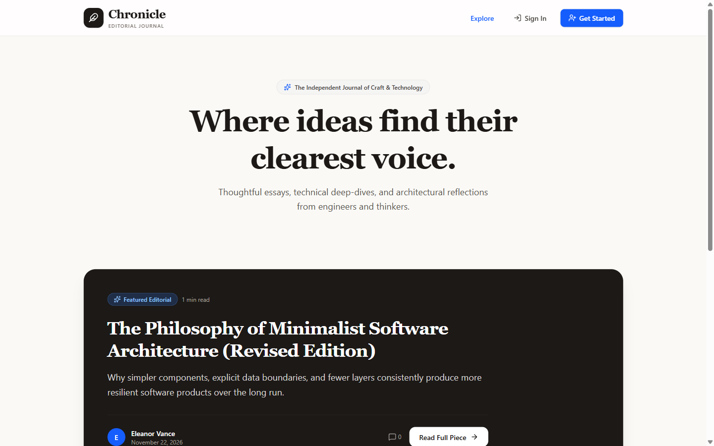
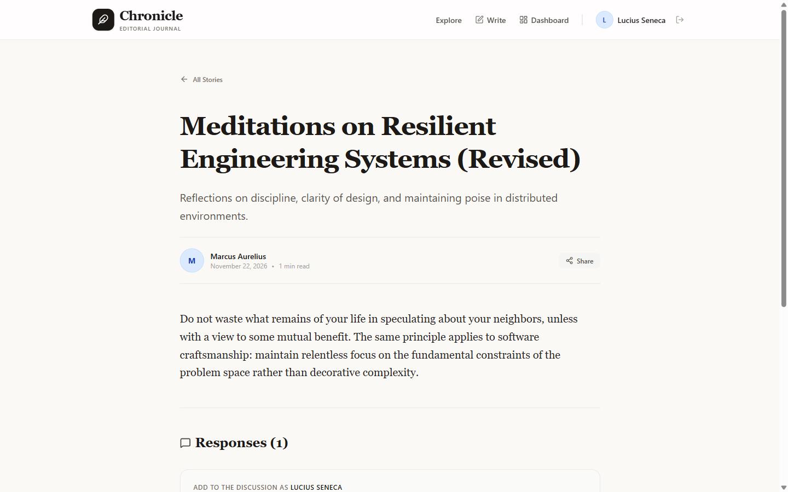
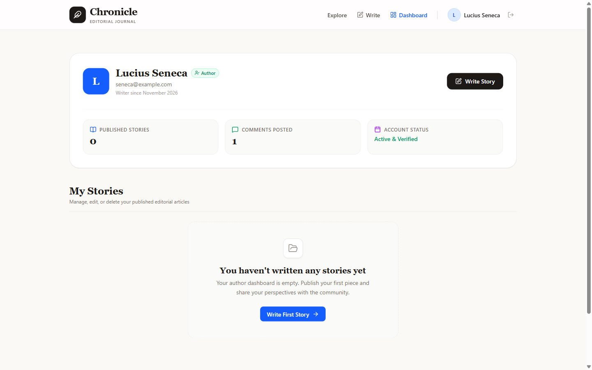
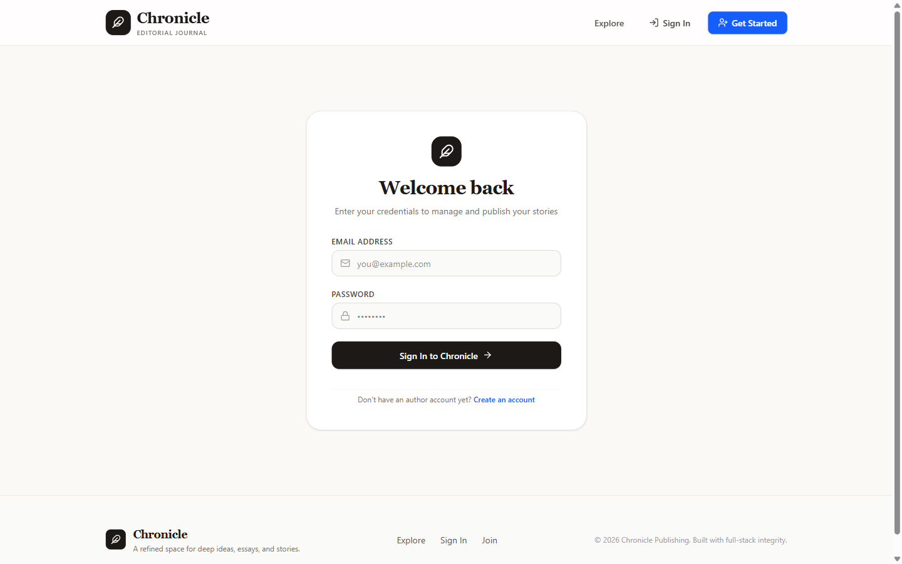

# Chronicle - Full-Stack Blog Platform with Comments

[](LICENSE)
[](https://www.typescriptlang.org/)
[](https://react.dev/)
[](https://tailwindcss.com/)
[](https://expressjs.com/)
[](https://www.prisma.io/)
[](https://www.postgresql.org/)

**Chronicle** is a production-grade, editorial blogging platform inspired by publications like *Medium* and *Hashnode*. It features end-to-end user registration and JWT authentication, rich editorial publishing, comments with owner deletion rights, robust relational integrity with PostgreSQL, rate-limited and Helmet-secured REST APIs, and a responsive interface tested across mobile, tablet, and desktop viewports.

---

## Visual Showcase

| Home Editorial Feed | Single Story & Discussion |
| :---: | :---: |
|  |  |

| User Dashboard & Statistics | Authentication |
| :---: | :---: |
|  |  |

---

## Features

- **Authentication & Security**:
  - Secure user registration and login with `bcryptjs` password hashing (10 salt rounds).
  - JWT token generation and authentication via HTTP Bearer headers.
  - Rate limiting on auth endpoints with `express-rate-limit` (100 reqs / 15 mins).
  - HTTP security headers via `helmet`.
  - Body payload size restrictions (`1mb`) preventing memory exhaustion attacks.
  - Automatic eviction of expired or invalid tokens from local state.
- **Blog Management (CRUD)**:
  - Create, read, update, and delete stories.
  - Strict ownership authorization: only the original post author can edit or delete their story.
  - Paginated blog listing with live debounced search by title and summary.
  - Word count, reading time calculator, and excerpt generation.
- **Community Discussion & Comments**:
  - Authenticated readers can post comments (up to 1,000 characters).
  - Owner-only comment deletion controls with confirmation modal.
  - PostgreSQL cascading deletes: removing a post automatically purges all attached comments.
- **Design & User Experience**:
  - Minimalist editorial design with elegant typography.
  - Skeleton loading states, interactive empty states, and toast/error alerts.
  - Fully responsive on **Mobile (375px/390px)**, **Tablet (768px)**, and **Desktop (1440px)**.
  - Zero broken images, zero horizontal overflow.

---

## Technology Stack

### Frontend
- **Library/Framework**: React 19 + Vite + TypeScript
- **Styling**: Tailwind CSS 4 (`@tailwindcss/vite`)
- **Routing**: React Router v7
- **HTTP Client**: Axios with global interceptors for Bearer auth
- **Icons**: Lucide React
- **Date Utilities**: date-fns

### Backend
- **Runtime**: Node.js v24
- **Framework**: Express.js with TypeScript
- **ORM**: Prisma ORM v6
- **Database**: PostgreSQL 18.6
- **Validation**: Zod schema parsing
- **Security**: bcryptjs, jsonwebtoken, helmet, express-rate-limit, cors

### Testing & QA
- **Automated Tests**: Jest + ts-jest + Supertest (20/20 test cases passing)
- **Browser Automation & Inspection**: Playwright
- **API Tooling**: Postman collection & environment

---

## Project Structure

```
d:\Projects\Blog\
├── backend\                      # Express + TypeScript + Prisma backend
│   ├── prisma\
│   │   ├── migrations\           # Applied database migrations
│   │   └── schema.prisma         # Relational schema (User, Post, Comment)
│   ├── src\
│   │   ├── config\               # Environment configuration & DB client
│   │   ├── controllers\          # Auth, Post, and Comment controllers
│   │   ├── middleware\           # Auth guard, error handler, rate limiters, validate
│   │   ├── routes\               # Express router modules
│   │   ├── schemas\              # Zod validation schemas
│   │   ├── services\             # Business logic layer
│   │   ├── utils\                # JWT, bcrypt, pagination, apiError
│   │   ├── app.ts                # Express app setup with Helmet & CORS
│   │   └── server.ts             # Server entry point
│   ├── tests\                    # Jest integration test suite
│   ├── .env.example
│   ├── package.json
│   └── tsconfig.json
│
├── frontend\                     # React 19 + Vite + Tailwind CSS 4 frontend
│   ├── src\
│   │   ├── components\           # Navbar, Footer, PostCard, FeaturedPost, Modals
│   │   ├── context\              # AuthContext (session state, login, register, logout)
│   │   ├── pages\                # Home, BlogDetails, CreateBlog, EditBlog, Dashboard, Login, Register
│   │   ├── services\             # Axios API client & typed endpoints
│   │   ├── types\                # Shared TypeScript definitions
│   │   ├── App.tsx               # App routing configuration
│   │   ├── index.css             # Tailwind 4 styling configuration
│   │   └── main.tsx
│   ├── .env.example
│   ├── package.json
│   └── vite.config.ts
│
├── postman\                      # Postman collection & environment files
│   ├── Blog-Platform.postman_collection.json
│   └── Blog-Platform.postman_environment.json
├── screenshots\                  # Visual audit screenshots
├── API_DOCUMENTATION.md          # REST API specifications
├── DATABASE_SETUP.md             # PostgreSQL migration & setup guide
├── DEPLOYMENT_READINESS.md       # Deployment instructions & hosting guide
├── INTEGRATION_TEST_REPORT.md    # Integration test report
├── SECURITY_AUDIT.md             # Production security audit
├── REQUIREMENTS_CHECKLIST.md     # Verified requirements tracking
└── README.md
```

---

## Getting Started

### 1. Prerequisites
- **Node.js**: v20 or higher (tested on v24.21.0)
- **PostgreSQL**: v14 or higher (running locally on port `5432` or via cloud provider)
- **npm**: v10 or higher

### 2. Database Setup
Create the PostgreSQL database:
```sql
CREATE DATABASE blogdb;
```

### 3. Backend Setup
```bash
# Navigate to backend directory
cd backend

# Install dependencies
npm install

# Configure environment variables
cp .env.example .env
# Ensure DATABASE_URL, PORT, and JWT_SECRET are set in .env

# Run migrations and generate Prisma Client
npx prisma migrate dev
npx prisma generate

# Start backend server
npm run dev
# The backend will be available at http://localhost:5000
```

### 4. Frontend Setup
```bash
# In a new terminal, navigate to frontend directory
cd frontend

# Install dependencies
npm install

# Configure environment variables
cp .env.example .env
# Default VITE_API_BASE_URL is http://localhost:5000/api

# Start Vite development server
npm run dev
# The frontend will be available at http://localhost:5173
```

---

## Running Automated Tests

```bash
# Run backend integration test suite (executes against isolated blogdb_test)
cd backend
npm test

# Run TypeScript compilation check
npm run build

# Run frontend production build
cd ../frontend
npm run build
```

---

## API Summary

| Method | Endpoint | Description | Auth Required |
|---|---|---|:---:|
| `POST` | `/api/auth/register` | Register new user account | No |
| `POST` | `/api/auth/login` | Authenticate and obtain JWT | No |
| `GET` | `/api/auth/me` | Get active user profile and post statistics | Yes |
| `GET` | `/api/posts` | List paginated stories with search filter | No |
| `GET` | `/api/posts/:id` | Get single post details and comments | No |
| `POST` | `/api/posts` | Create new blog story | Yes |
| `PUT` | `/api/posts/:id` | Edit blog post (author only) | Yes |
| `DELETE` | `/api/posts/:id` | Delete blog post (author only, cascading) | Yes |
| `GET` | `/api/posts/:id/comments` | List all comments for post | No |
| `POST` | `/api/posts/:id/comments` | Add comment to post | Yes |
| `DELETE` | `/api/comments/:id` | Delete comment (comment owner only) | Yes |

*See [API_DOCUMENTATION.md](API_DOCUMENTATION.md) for complete payload schemas and examples.*

---

## Postman API Collection

Import the included files located in the `postman/` directory:
1. `postman/Blog-Platform.postman_collection.json`
2. `postman/Blog-Platform.postman_environment.json`

Variables `authToken`, `currentPostId`, and `currentCommentId` are automatically extracted and populated after login, post creation, and comment creation.

---

## Security Highlights

- **Zero Plaintext Passwords**: Hashed via `bcryptjs` (10 rounds).
- **HTTP Security Headers**: Enforced via `helmet` (`nosniff`, `SAMEORIGIN`, CSP).
- **Injection Immunization**: Parameterized queries via Prisma; JSX text escaping in React.
- **Payload Constraint**: `express.json({ limit: "1mb" })` prevents memory exhaustion.
- **Strict Authorization**: Server-enforced verification (`authorId === req.user.id`) for all modification/deletion operations.

---

## Repository & Author Information

- **GitHub Repository**: [https://github.com/AshwinKirbaa/Blog-Platform](https://github.com/AshwinKirbaa/Blog-Platform)
- **Author**: Ashwin Kirbaa
- **License**: MIT
